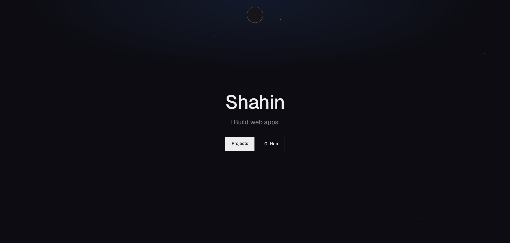
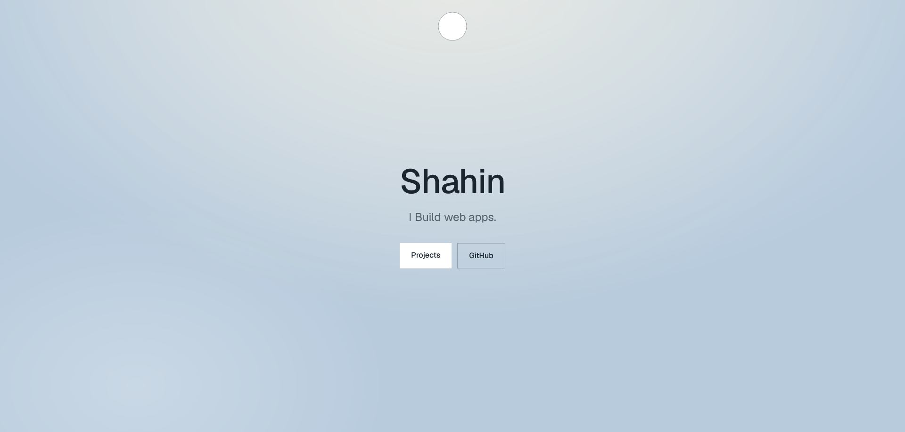

# Portfolio

Personal portfolio site. Built to feel like its own thing rather than a template.

**[Live site](https://shahin-portfolio-dev.vercel.app)**

---

## Screenshots

### Dark



### Light



---

## What's in it

- Custom theme system with a circular reveal animation
- Cross-browser fallback for Firefox (View Transitions + clip-path rendering bug)
- Scroll-triggered reveal on the capabilities section
- Hover-to-play video preview on project cards
- Hand-written CSS with a semantic color token system

---

## Stack

- Next.js 16 (App Router)
- TypeScript
- Tailwind CSS v4
- No UI libraries, no animation libraries

---

## Run locally

```bash
npm install
npm run dev